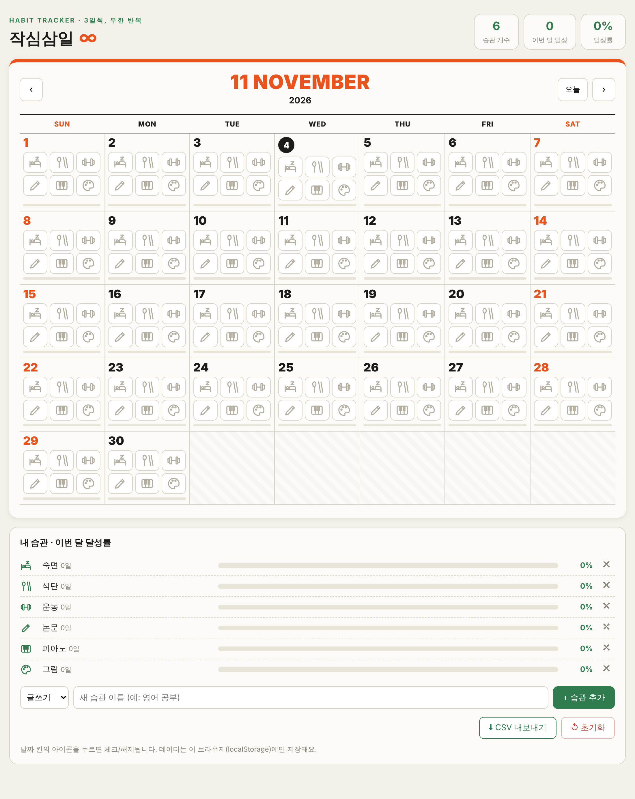

# 작심삼일 ∞

작심삼일도 무한 반복하면 습관이 된다. 월간 달력 위에서 매일 체크하는 습관 트래커입니다.

## 습관 (기본값)

| 윗줄 | 숙면 | 식단 | 운동 |
|---|---|---|---|
| 아랫줄 | 논문 | 피아노 | 그림 |

## 기능

- 날짜 칸의 아이콘을 눌러 체크/해제 (일요일 시작 달력)
- 하루 달성도 막대, 습관을 모두 채운 날은 초록색 표시
- 습관 추가·삭제, 월별 습관별 달성률
- CSV 내보내기
- 기록은 브라우저 localStorage에 저장 (서버 불필요, 기기별로 따로 저장)

## 습관 바꾸기

`index.html`의 `DEFAULT_HABITS`를 수정하거나, 페이지 아래 "내 습관" 패널에서 직접 추가·삭제합니다.

## GitHub Pages로 배포

저장소 Settings → Pages → Branch: `main` / root 선택 후 저장.
